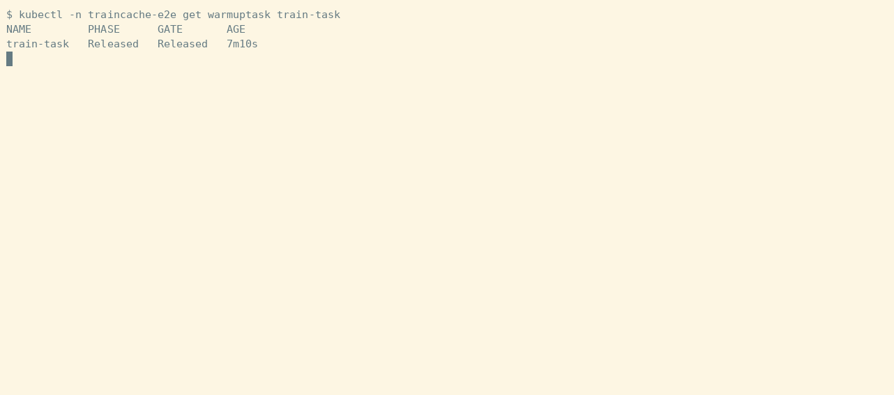
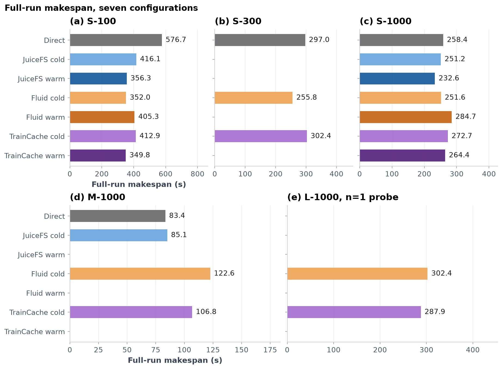
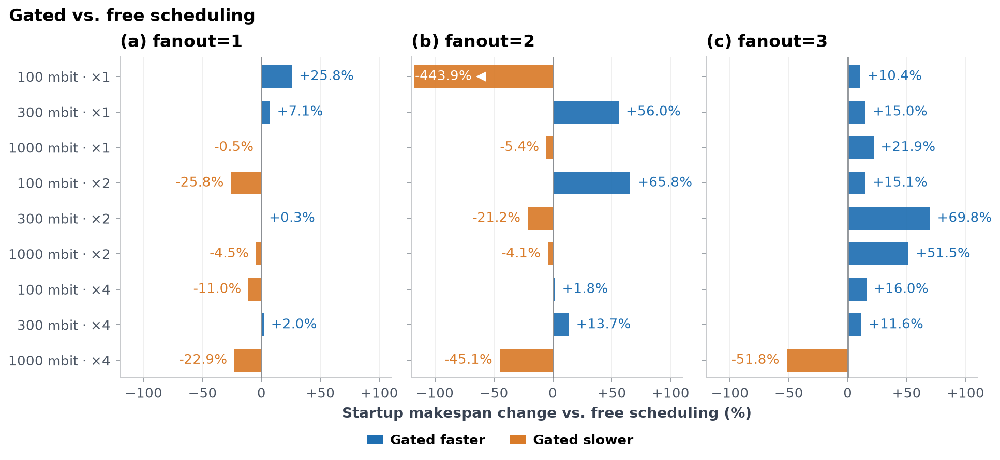
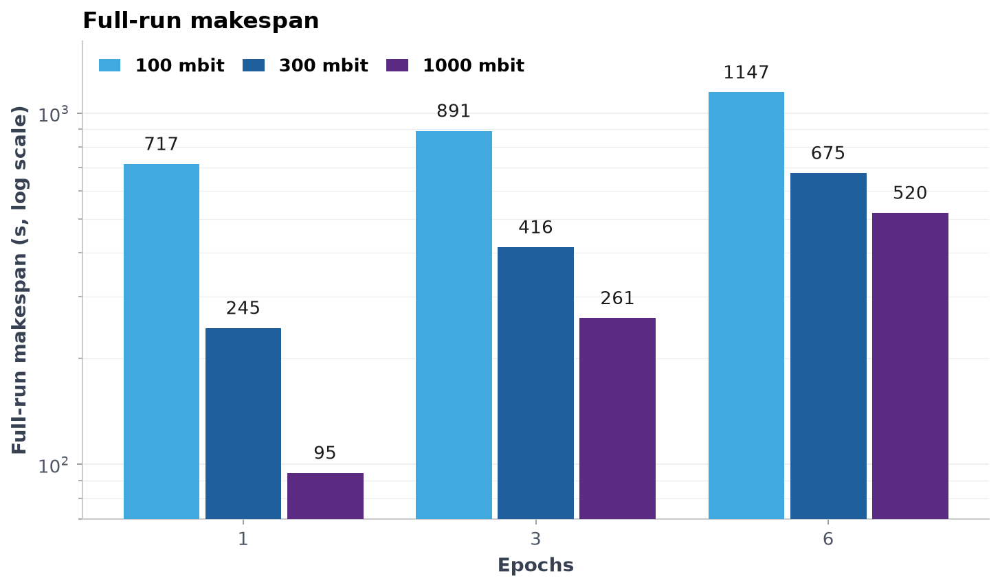
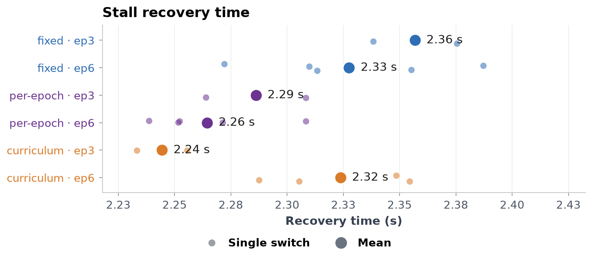
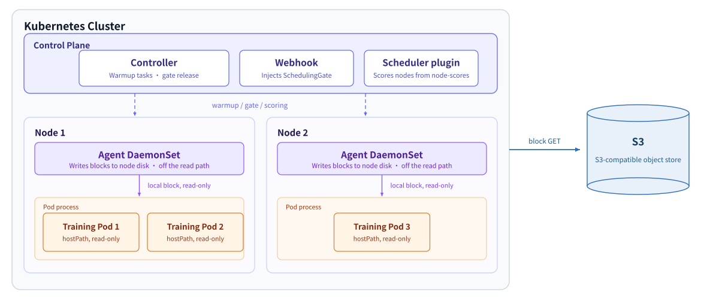

English | [简体中文](README.zh-CN.md)

# TrainCache

TrainCache speeds up training data access on Kubernetes. It fetches dataset blocks into node-local disk before a Pod is scheduled, uses warmup progress to decide which node the Pod lands on, and keeps prefetching the blocks training reads next.

[](https://github.com/TheWor1d877/TrainCache/actions/workflows/verify.yml)    


```bash
make e2e    # create a kind cluster, load images, run six assertions
```



*Figure 1: resources queried after `make e2e`. The WarmupTask is Released, both training Pods sit on nodes labeled `traincache.io/s3-access=true`, and the Pod annotation `node-scores` reads 100.*

## Background

Fluid 1.1.0-alpha.9 runs DataLoad independently of scheduling: a Pod enters scheduling right after creation, and warmup progress plays no part in node selection ([field survey](docs/3-field-survey.md) §2.2). JuiceFS Community Edition ships a local cache only; distributed cache groups, IORPC and RDMA are Enterprise features (ibid. §0). A training Pod stays on one node from epoch 0 to the end. Epoch and shuffle switches happen inside the Pod and never trigger rescheduling, so data laid down at startup goes stale in later epochs and nothing fetches ahead.

## Features

- After a `WarmupTask` is submitted, the webhook injects the `traincache.io/warmup` SchedulingGate into matching training Pods, which stay Pending. The controller requests blocks from candidate nodes per Pod shard and removes the gate once block readiness reaches the threshold `M`.
- If readiness is still below `M` after `t_max`, the controller removes the gate and the Pod schedules normally ([protocol](docs/4.4-experiment-protocol.md) §2).
- The scheduler plugin reads the Pod annotation `traincache.io/node-scores`, scores candidate nodes by readiness with global position decay, and picks the highest score.
- Once the Pod is scheduled, agentd prefetches the next blocks in the order training consumes them. When an epoch, shuffle or curriculum switch arrives, it re-lays blocks in the new order (`agent/ordersrc/`).
- Bytes fetched to candidate nodes during warmup are counted in `startup_warmup_bytes`; bytes fetched during sustained prefetch are counted in `sustained_prefetch_bytes`. Every configuration in a cell shares these definitions ([protocol](docs/4.4-experiment-protocol.md) §1.5).

## Quick start

Requirements: Kubernetes 1.28+, kubectl, openssl and an S3-compatible bucket. Release artifacts target linux/amd64; e2e passes on `kindest/node:v1.37.0`.

**1. Install the control plane.** Five images are pinned by digest:

```bash
curl -LO https://github.com/TheWor1d877/TrainCache/releases/download/v0.4.1/install.yaml
kubectl apply -f install.yaml
```

**2. Webhook certificate.** `caBundle` in the manifest is empty. Generate a server certificate and patch it in:

```bash
NS=traincache; SVC=traincache-webhook
TLS=$(mktemp -d)
openssl req -x509 -newkey rsa:2048 -nodes -days 365 -keyout "$TLS/ca.key" -out "$TLS/ca.crt" -subj "/CN=traincache-ca"
openssl req -newkey rsa:2048 -nodes -keyout "$TLS/tls.key" -out "$TLS/tls.csr" -subj "/CN=$SVC"
printf 'subjectAltName=DNS:%s,DNS:%s.%s.svc.cluster.local\n' "$SVC" "$SVC" "$NS" >"$TLS/san.ext"
openssl x509 -req -in "$TLS/tls.csr" -CA "$TLS/ca.crt" -CAkey "$TLS/ca.key" -CAcreateserial -out "$TLS/tls.crt" -days 365 -extfile "$TLS/san.ext"
kubectl -n "$NS" create secret tls traincache-webhook-tls --cert="$TLS/tls.crt" --key="$TLS/tls.key"
kubectl patch mutatingwebhookconfiguration traincache-pod-warmup --type=json \
  -p "[{\"op\":\"replace\",\"path\":\"/webhooks/0/clientConfig/caBundle\",\"value\":\"$(base64 -w0 "$TLS/ca.crt")\"}]"
```

The certificate is valid for 365 days. The SAN covers the Service name and the DNS name inside the namespace.

**3. Bucket and credentials.** `DataSet.spec` takes `endpoint` (no scheme), `bucket` and `secretRef`. The Secret holds `accessKey` and `secretKey` and lives in the same namespace as the DataSet. For bucket setup see [cloud object storage deployment](docs/0-cloud-object-storage-deployment.md).

**4. Verify the control plane.**

```bash
kubectl -n traincache rollout status deploy/traincache-controller-manager --timeout=300s
kubectl -n traincache get pods
```

```text
NAME                                             READY   STATUS
traincache-agentd-<hash>                         1/1     Running
traincache-controller-manager-<hash>             1/1     Running
traincache-gateway-<hash>                        1/1     Running
traincache-webhook-<hash>                        1/1     Running
```

Pod name suffixes vary with node and ReplicaSet. The scheduler runs in `kube-system`; check it with `kubectl -n kube-system rollout status deploy/traincache-scheduler`. A sample training Pod is in `agent/deploy/train-pod.yaml`; `DataSet` and `WarmupTask` fields are in [4.3 startup and experiments](docs/4.3-startup-and-experiments.md).

Uninstall:

```bash
kubectl delete -f install.yaml
```

## Results

Seven configurations: direct, JuiceFS cold/hot, Fluid cold/hot and TrainCache cold/hot, three runs per workload shape. Values are means; bootstrap 95% intervals are in the `ci_low` and `ci_high` columns of the CSV. Data version `v0.4.0`; aggregates used in the figures are in [`compare_total_v0.4.0.csv`](docs/assets/data/compare_total_v0.4.0.csv). L-1000 has a single run.

| Cell | direct | Fluid cold | TrainCache cold | TrainCache hot | n |
|---|---:|---:|---:|---:|---:|
| S-100 | 576.7 | 352.0 | 412.9 | 349.8 | 3 |
| S-300 | 297.0 | 255.8 | 302.4 | — | 3 |
| S-1000 | 258.4 | 251.6 | 272.7 | 264.4 | 3 |
| M-1000 | 83.4 | 122.6 | 106.8 | — | 3 |
| L-1000 | — | 302.4 | 287.9 | — | 1 |

- S-100 (100 mbit, 2 GiB): direct 576.7 s, TrainCache cold 412.9 s, 163.7 s less (28.4%); TrainCache hot 349.8 s. Fluid cold 352.0 s, 60.9 s faster than TrainCache cold.
- Stall share in the same cell drops from 52.9% (direct) to 0.1% (TrainCache cold). Cold warmup took 124.3 s, and the total still beats direct.
- At 1000 mbit, gated warmup is net overhead: S-1000 goes from 258.4 s to 272.7 s (5.6%), M-1000 from 83.4 s to 106.8 s (28.1%).
- After a switch, stall recovery lands between 2.24 s and 2.36 s across six cells. The 0.11 s spread (4.9%) stays below the 20% criterion in the protocol.



*Figure 2: full-run makespan for five cells and seven configurations. Bars are configuration means; shorter is better.*



*Figure 3: makespan change from startup gating against free scheduling, split by fanout. Blue bars to the right mean gating is faster, orange bars to the left mean slower. The −443.9% cell is clipped at the axis end and marked `◀`.*



*Figure 4: full-run makespan at three bandwidths and 1, 3 and 6 epochs. Measured values sit above the bars; the y-axis is log scale.*



*Figure 5: stall recovery after a shuffle × epoch switch, six cells. Small dots are single switch events, large dots are means, and values are labeled on the right.*

## Architecture



*Figure 6: each node runs one Agent DaemonSet that writes blocks to node-local disk; training Pods mount it read-only through hostPath.*

The control plane issues warmup tasks, gate releases and node scores, and stays out of the data path. agentd runs on every node, writes blocks to node-local disk, and training Pods mount that disk read-only through hostPath. agentd sits off the read I/O path, so read latency matches reading a local disk. Read-side signals come from a DataLoader hook and an inotify side channel.

Blocks come from one of two paths. With `gatewayEndpoint` empty, agentd talks to object storage directly. Once the field is set, agentd sends block GETs to the gateway, which merges duplicate requests into one origin fetch. The gateway is a single-replica Deployment listening on `:9413`; the contract and trade-offs are in [9.1 design](docs/9.1-design.md).

## Relationship to upstream

Fluid 1.1.0-alpha.9 and JuiceFS CE 1.3.0 were deployed and benchmarked on a kind cluster as control groups among the seven configurations ([field survey](docs/3-field-survey.md), [4.2 JuiceFS and Fluid](docs/4.2-juicefs-and-fluid.md)). The `DataSet` and `Runtime` naming and the nodeAffinity injection follow Fluid. Block readiness lives in `controller/cmd/controller-manager`, SchedulingGate injection in `controller/cmd/webhook`, node scoring in `controller/cmd/scheduler`, and prefetch in `agent/cmd/agentd`. No upstream code is vendored. Both projects are Apache-2.0: [fluid-cloudnative/fluid](https://github.com/fluid-cloudnative/fluid), [juicedata/juicefs](https://github.com/juicedata/juicefs).

## Known limitations

- Experiments cover a five-node kind cluster, 2/8/32 GiB datasets and a 1 GiB cache. Cross-cluster, multi-tenant and GPU training are untested.
- Gated warmup does not pay off at 1000 mbit: M-1000 is 28.1% slower and S-1000 5.6% slower. Gating only helps when bandwidth is limited and the working set exceeds the cache.
- The read path needs a local disk on each node. agentd stays off the read I/O path, and read signals come from a side channel, so accuracy depends on hook coverage.
- Sustained prefetch with lookahead 16 and 32 loses 7.4% and 17.3% against lookahead 8 (n=2). No positive setting was found.
- The gateway runs a single replica; multi-replica scaling is not implemented.
- Epochs are not scheduled. Epoch, shuffle and curriculum switches only change prefetch order inside a node and stay out of scheduling.

## Build and test

```bash
make verify           # build, vet, go test -race and gofmt for three modules
make verify-metadata  # version fields, image names, relative doc links
hack/build-images.sh  # five development images (:dev)
make e2e              # six assertions in a kind cluster
```

`make e2e` covers six assertions: webhook gate injection, warmup progress and gate release, Pod binding to the custom scheduler, `node-scores` annotation parsing, the scheduler reading that annotation, and the `NodeDeviation` event. The `verify` workflow in CI runs the same unit tests plus the MinIO integration test.

## Documents

Documents under `docs/` are written in Chinese.

| Document | Contents |
|---|---|
| [1 Introduction and background](docs/1-introduction-and-background.md) | Problem statement, external facts, positioning against Fluid and JuiceFS |
| [2 Three-layer architecture](docs/2-three-layer-architecture.md) | Control plane, node plane, data sources and data-plane conventions |
| [3 Field survey](docs/3-field-survey.md) | How Fluid and JuiceFS work, and the gaps found |
| [4.0 Bench guide](docs/4.0-bench-guide.md) | Division of work across 4.1–4.6 and standing commands |
| [4.1 Bench setup and rules](docs/4.1-bench-setup-and-rules.md) | Rig, parameters, data locations and prohibitions |
| [4.2 JuiceFS and Fluid](docs/4.2-juicefs-and-fluid.md) | Images, startup, warmup, runs and teardown for the control groups |
| [4.3 Startup and experiments](docs/4.3-startup-and-experiments.md) | Image builds, control plane startup, experiment families |
| [4.4 Experiment protocol](docs/4.4-experiment-protocol.md) | Pre-registered hypotheses, metric definitions, condition matrix and criteria |
| [4.5 Metric decisions](docs/4.5-metric-decisions.md) | Rulings on acceptance and metric definitions |
| [4.6 Experiment version log](docs/4.6-experiment-version-log.md) | Version × experiment family matrix and artifact paths |
| [5.x Cache core library](docs/5.1-design.md) | Requirements, plan, decisions and tests |
| [6.x Agent service](docs/6.1-design.md) | Node-plane interfaces and decisions |
| [7.x Controller and Scheduler](docs/7.1-design.md) | Control-plane interfaces and decisions |
| [8.x Logging and monitoring](docs/8.1-design.md) | Metrics, log contract and usage |
| [9.x Merge gateway](docs/9.1-design.md) | Gateway contract, decisions and tests |
| [Release constraints](docs/RELEASE-CONSTRAINTS.md) | Versions, images, artifacts and CI rules |

## License

Apache-2.0, see [LICENSE](LICENSE).
