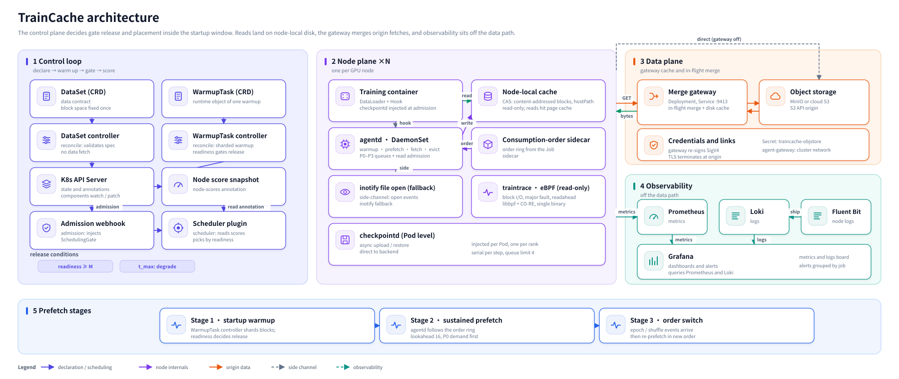
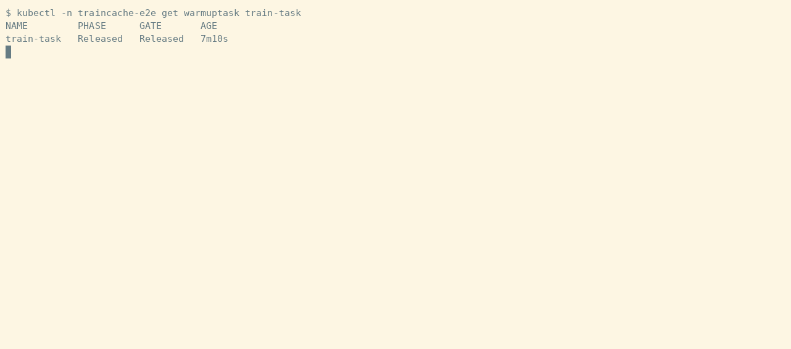
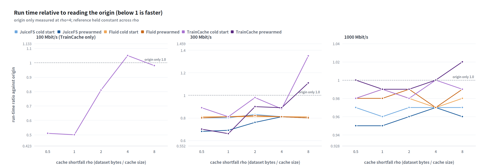
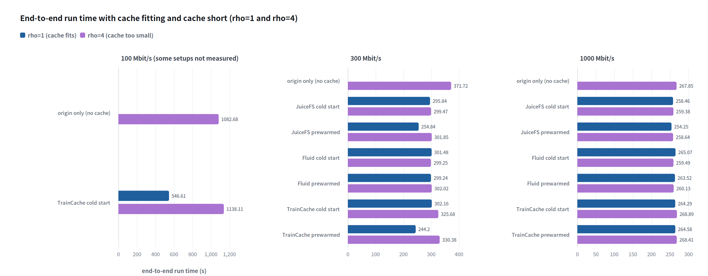
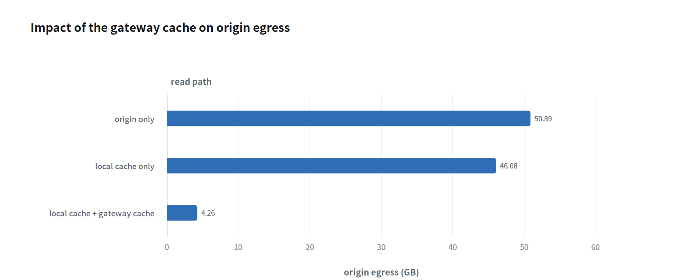
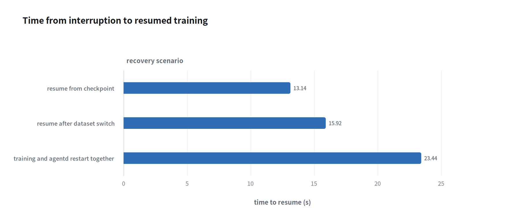

English | [简体中文](README.zh-CN.md)

# TrainCache

TrainCache runs on Kubernetes. It fetches dataset blocks into node-local disk before a Pod is scheduled, uses warmup progress to decide which node the Pod is placed on, and keeps prefetching the blocks training reads next.

[](https://github.com/TheWor1d877/TrainCache/actions/workflows/verify.yml)    

<picture><source media="(prefers-color-scheme: dark)" srcset="docs/assets/logo/traincache-lockup-dark.svg"></picture>



*Figure 1: control plane, node plane, data plane and observability. The gateway merges in-flight requests and caches blocks; traintrace observes block I/O from eBPF; checkpointd runs as a Pod-level sidecar.*

```bash
make e2e    # create a kind cluster, load images, run six assertions
```



*Figure 2: resources queried after `make e2e`. The WarmupTask is Released, both training Pods sit on nodes labeled `traincache.io/s3-access=true`, and the Pod annotation `node-scores` reads 100.*

## Background

Fluid 1.1.0-alpha.9 runs DataLoad apart from scheduling: a Pod enters scheduling right after creation, and warmup progress plays no part in node selection ([field survey](docs/3-field-survey.md), the zero webhook injection diff section). JuiceFS Community Edition ships a local cache only; distributed cache groups, IORPC and RDMA are Enterprise features (ibid., the conclusion section). A training Pod stays on one node from epoch 0 to the end. Epoch and shuffle switches happen inside the Pod and trigger no rescheduling, so the blocks written at startup stop matching what later epochs read, and no component fetches ahead of the reader.

## Where it applies

TrainCache targets training workloads where data has to be fetched from remote storage, the consumption order can be computed ahead of time, and fetch bandwidth is the bottleneck. It pulls blocks onto the node's local disk before the Pod is scheduled, uses block-level readiness to decide which node the Pod lands on, and keeps prefetching later blocks in the order training consumes them.

### Workload classes

| Workload | Dataset size | Consumption pattern | Where TrainCache sits |
|---|---|---|---|
| Large-scale pretraining | TB to PB | Mostly consumed once | Disadvantage region: the working set does not fit the node cache, reuse ratio is low |
| Intermediate training, large-scale fine-tuning | Hundreds of GB to a few TB | Consumed repeatedly across runs and epochs | Advantage region |
| Task-specific fine-tuning, domain training | A few GB to hundreds of GB | Repeated iterations | Edge of the advantage region: reuse from the iterations offsets part of the fixed system cost |
| Streaming, online data | No fixed total | Consumption order cannot be computed | Not applicable: neither order-based prefetch nor the gate can be set up from the Job spec |

### Conditions for the advantage region

Four conditions hold at once:

1. Data has to be fetched from remote storage. The local disk cannot hold the whole working set, or the cold start has no local copy.
2. The consumption order can be computed ahead of time. Epoch, shuffle seed and batch size are known from the Job spec.
3. Fetch bandwidth is the bottleneck. Going straight to the data source stalls the trainer when it reads a block.
4. The same data is consumed repeatedly: across epochs, across runs, and across cold starts on different nodes.

Two benefit paths cover different dataset sizes:

- **Reuse**: the dataset size (basis: total bytes of the whole dataset) falls between a fraction and a few multiples of the cache space available per node (basis: per node, taken as 8 to 12 TB), that is hundreds of GB to a few TB. The node cache holds most of the working set, so repeated consumption no longer goes back to remote storage.
- **Overlap**: when the working set exceeds the node cache, order-based prefetch makes the download and the compute run at the same time. The gain comes from that, and the cache reuse ratio is low there. The current experiments cover this path; see "Known limitations" for their scale.

One order of magnitude more data pushes the reuse ratio down and leaves only the overlap from order-based prefetch; one order of magnitude less data leaves the fixed cost of the controller, the gate, agentd, the order sidecar and the hook instrumentation above the gain.

### Conditions for the disadvantage region

- Large-scale pretraining with mostly single-pass consumption: the working set does not fit the node cache, the data is not consumed twice, and the cache reuse ratio stays low.
- Streaming and online data: the consumption order cannot be computed ahead of time, so neither order-based prefetch nor the gate can be set up from the Job spec.
- The node already has a copy: the image ships the data, or another job on the same node left a usable cache, which makes warmup a redundant action.
- The dataset is far larger than the cache space of the whole cluster: the cache only serves as a streaming buffer and the reuse ratio approaches zero.

## Features

- After a `WarmupTask` is submitted, the webhook injects the `traincache.io/warmup` SchedulingGate into matching training Pods, which stay Pending. The controller requests blocks from candidate nodes per Pod shard and removes the gate once block readiness reaches the threshold `M`.
- If readiness is still below `M` after `t_max`, the controller removes the gate and the Pod goes through default scheduling ([metrics](docs/4.3-bench-metrics-and-decisions.md)).
- The scheduler plugin reads the Pod annotation `traincache.io/node-scores`, scores candidate nodes by readiness with global position decay, and picks the highest score.
- Once the Pod is scheduled, agentd prefetches the next blocks in the order training consumes them. When an epoch, shuffle or curriculum switch arrives, agentd prefetches in the new order (`agent/ordersrc/`).
- Bytes fetched to candidate nodes during warmup are counted in `startup_warmup_bytes`; bytes fetched during sustained prefetch are counted in `sustained_prefetch_bytes`. Every configuration in a cell shares these definitions ([metrics](docs/4.3-bench-metrics-and-decisions.md) §2).
- With `gatewayEndpoint` set, agentd sends block GETs to a single-replica gateway. The gateway merges in-flight duplicate requests and, with its disk cache enabled, serves repeated blocks from its own disk; it re-signs SigV4 with its own credentials and terminates TLS to the origin ([9.x gateway](docs/9.1-design.md)).
- Pods labeled `traincache.io/checkpoint` get an asynchronous checkpoint sidecar at admission. It copies checkpoint directories between the Pod volume and the backend, and its traffic bypasses the gateway ([10.x checkpoint](docs/10.1-design.md)).
- `traintrace` is a read-only eBPF binary that records block I/O latency, major faults and readahead waste per cgroup and process, and writes structured metrics per run ([11.x eBPF](docs/11.0-eBPF-observability-tools.md)).

## Quick start

Requirements: Kubernetes 1.28+, kubectl, openssl and an S3-compatible bucket. Release artifacts target linux/amd64; e2e passes on `kindest/node:v1.37.0`.

**1. Install the control plane.** Six images are pinned by digest: five deployment components plus the checkpoint sidecar image.

```bash
curl -LO https://github.com/TheWor1d877/TrainCache/releases/download/v0.9.3/install.yaml
kubectl apply -f install.yaml
```

**2. Webhook certificate.** `caBundle` in the manifest is empty. Generate a server certificate and patch it in:

```bash
NS=traincache; SVC=traincache-webhook
TLS=$(mktemp -d)
openssl req -x509 -newkey rsa:2048 -nodes -days 365 -keyout "$TLS/ca.key" -out "$TLS/ca.crt" -subj "/CN=traincache-ca"
openssl req -newkey rsa:2048 -nodes -keyout "$TLS/tls.key" -out "$TLS/tls.csr" -subj "/CN=$SVC"
printf 'subjectAltName=DNS:%s,DNS:%s.%s.svc.cluster.local\n' "$SVC" "$SVC" "$NS" >"$TLS/san.ext"
openssl x509 -req -in "$TLS/tls.csr" -CA "$TLS/ca.crt" -CAkey "$TLS/ca.key" -CAcreateserial -out "$TLS/tls.crt" -days 365 -extfile "$TLS/san.ext"
kubectl -n "$NS" create secret tls traincache-webhook-tls --cert="$TLS/tls.crt" --key="$TLS/tls.key"
kubectl patch mutatingwebhookconfiguration traincache-pod-warmup --type=strategic \
  -p "{\"webhooks\":[{\"name\":\"pods.traincache.io\",\"clientConfig\":{\"caBundle\":\"$(base64 -w0 "$TLS/ca.crt")\"}},{\"name\":\"pods-checkpoint.traincache.io\",\"clientConfig\":{\"caBundle\":\"$(base64 -w0 "$TLS/ca.crt")\"}}]}"
```

The certificate is valid for 365 days. The SAN covers the Service name and the DNS name inside the namespace. The CA goes into both webhook entries: the checkpoint entry has `failurePolicy: Fail`, so a Pod labeled `traincache.io/checkpoint` (the label value names a ConfigMap in the same namespace) is rejected when its `caBundle` is empty.

**3. Bucket and credentials.** `DataSet.spec` takes `endpoint` (no scheme), `bucket` and `secretRef`. The Secret holds `accessKey` and `secretKey` and lives in the same namespace as the DataSet. For bucket setup see [cloud object storage deployment](docs/0-cloud-object-storage-deployment.md).

**4. Verify the control plane.**

```bash
kubectl -n traincache rollout status deploy/traincache-controller-manager --timeout=300s
kubectl -n traincache get pods
```

```text
NAME                                             READY   STATUS
traincache-agentd-<hash>                         1/1     Running
traincache-controller-manager-<hash>             1/1     Running
traincache-gateway-<hash>                        1/1     Running
traincache-webhook-<hash>                        1/1     Running
```

The scheduler runs in `kube-system`; check it with `kubectl -n kube-system rollout status deploy/traincache-scheduler`. A sample training Pod is in `agent/deploy/train-pod.yaml`; `DataSet` and `WarmupTask` fields are in [4.4 runbook](docs/4.4-bench-runbook.md).

Uninstall:

```bash
kubectl delete -f install.yaml
```

## Results

Eleven families ran on a kind cluster against v0.9.3: 145 cells and 432 valid samples, three runs per cell (two for e2e). The comparison family covers direct reads, JuiceFS and Fluid (cold and prewarmed) and TrainCache (cold and prewarmed) at 100, 300 and 1000 Mbit/s over ρ=0.5–8, where ρ is dataset bytes divided by per-node cache size. Values are cell means; per-cell summary files are in `docs/assets/data/bench-v0.9.3/`. The charts and the interactive pages come from `python3 bench/experiments/plot_echarts.py`; all twenty charts and their notes are on the [benchmark charts](https://thewor1d877.github.io/TrainCache/) page, which opens in English and switches to Chinese.

The result splits at ρ=1. At or below 1 the node cache holds the working set and reuse carries the gain. Above 1 the hit rate falls under 0.32 and the run is bounded by the origin read path.



*Figure 3: run time of each configuration divided by the direct-read run at the same bandwidth; below the dashed 1.0 line is faster. At 100 Mbit/s and ρ≤1, TrainCache takes 547 s against 1083 s for direct reads. At 300 Mbit/s the prewarmed run is 55 s faster than prewarmed Fluid. The cold 300 Mbit/s, ρ=8 cell is 35% slower than direct. Origin reads were measured only at ρ=4 and are held constant.*



*Figure 4: ρ=1 against ρ=4 at the same bandwidth. At 100 Mbit/s the cold run is 49% faster than direct reads; at 300 Mbit/s the prewarmed run is 18% faster than prewarmed Fluid. At ρ=4 the 300 Mbit/s cold run is 9% slower than cold Fluid, and the 100 Mbit/s run is 5% slower than direct reads. The 100 Mbit/s facet has no Fluid or JuiceFS runs.*

The remaining families vary one subsystem at a time on the same apparatus.



*Figure 5: origin egress by read path: 50.9 GB with origin reads, 46.1 GB with the local cache alone, and 4.3 GB with the local cache plus the gateway. The gateway merges duplicate block reads into one origin fetch, which cuts egress by 92%.*



*Figure 6: checkpoint resume 13.1–13.2 s, dataset switch 14.3–17.6 s, training and agentd restart together 22.0–24.9 s. Read errors in the recovery window are zero.*

- Eviction: ρ=1 the three policies take 76–79 s, within noise; ρ=8 heat priority takes 132 s, LRU 143 s and LFU 148 s.
- Prefetch: lookahead 8 is best (273 s at ρ=8) and lookahead 32 is worst (337–359 s); raising the replica count from 1 to 3 brings no gain.
- Warmup gating: at ρ=1 a 60 s wait limit cuts startup from 32.8 s to 3.4 s; at ρ=8 gating adds 0.3–2.0 s.
- Order switch: all four patterns settle in 2.3 s at ρ=1 and take 6.5–11.4 s at ρ=8.
- Two jobs sharing a cache: the hit rate stays at 0.39–0.42; same-node placement takes 408–412 s and cross-node 413–418 s.
- Parallel connections: four connections cut run time to 2.7×, 4.3× and 3.9× of a single connection under the three constrained links.
- Chaos: six faults end in PASS after the fix.

## Known limitations

At 300 Mbit/s with ρ>1, TrainCache is slower than Fluid and JuiceFS. The hit rate falls to 0.09–0.13 at ρ=4 and 0.04–0.05 at ρ=8, agentd opens few origin connections, and duplicate block reads from different Pods are not merged, so the refetch path cannot fill the link. The gateway that merges duplicate reads is measured as its own family and is not enabled in the comparison cells. This range sits outside the reuse region the design targets; raising agentd's origin concurrency and enabling the gateway in the comparison family are follow-up work.

## Architecture

The control plane issues warmup tasks, gate releases and node scores, and stays out of the data path. agentd runs on every node and writes blocks to node-local disk; training Pods mount that directory read-only through hostPath, so reads never pass through agentd. Read-side signals come from a DataLoader hook and an inotify side channel.

Blocks come from one of two paths. With `gatewayEndpoint` empty, agentd sends every request to object storage. Once the field is set, agentd sends block GETs to the gateway, which merges duplicate requests into one origin fetch. The gateway is a single-replica Deployment listening on `:9413`; the contract and trade-offs are in [9.1 design](docs/9.1-design.md).

## Relationship to upstream

Fluid 1.1.0-alpha.9 and JuiceFS CE 1.3.0 were deployed and benchmarked on a kind cluster as control groups among the seven configurations ([field survey](docs/3-field-survey.md), [4.1 apparatus](docs/4.1-bench-apparatus.md)). The `DataSet` and `Runtime` naming and the nodeAffinity injection follow Fluid. Block readiness lives in `controller/cmd/controller-manager`, SchedulingGate injection in `controller/cmd/webhook`, node scoring in `controller/cmd/scheduler`, and prefetch in `agent/cmd/agentd`. No upstream code is vendored. Both projects are Apache-2.0: [fluid-cloudnative/fluid](https://github.com/fluid-cloudnative/fluid), [juicedata/juicefs](https://github.com/juicedata/juicefs).

## Build and test

```bash
make verify           # build, vet, go test -race and gofmt for three modules
make verify-metadata  # version fields, image names, relative doc links
hack/build-images.sh  # development images (tag matches manifests)
make e2e              # six assertions in a kind cluster
```

`make e2e` covers six assertions: webhook gate injection, warmup progress and gate release, Pod binding to the custom scheduler, `node-scores` annotation parsing, the scheduler reading that annotation, and the `NodeDeviation` event. The `verify` workflow in CI runs the same unit tests plus the MinIO integration test.

## Documents

Documents under `docs/` are written in Chinese.

| Document | Contents |
|---|---|
| [0 Cloud object storage deployment](docs/0-cloud-object-storage-deployment.md) | Bucket setup and credentials for S3-compatible storage |
| [1 Introduction and background](docs/1-introduction-and-background.md) | Problem statement, external facts, positioning against Fluid and JuiceFS |
| [2 Three-layer architecture](docs/2-three-layer-architecture.md) | Control plane, node plane, data sources and data-plane conventions |
| [3 Field survey](docs/3-field-survey.md) | How Fluid and JuiceFS work, and the gaps found |
| [4.1 Apparatus and variable space](docs/4.1-bench-apparatus.md) | Rig, ρ ladder, parameters, data generation and locations |
| [4.2 Families and grids](docs/4.2-bench-families.md) | Eleven experiment families, cell matrices, COND contract, machine-hour account |
| [4.3 Metrics and decisions](docs/4.3-bench-metrics-and-decisions.md) | Metric formulas, pass criteria, numbered decisions |
| [4.4 Runbook](docs/4.4-bench-runbook.md) | Environment, startup, data preparation, running a family, troubleshooting, artifacts |
| [5.x Cache core library](docs/5.1-design.md) | Requirements, plan, decisions and tests |
| [6.x Agent service](docs/6.1-design.md) | Node-plane interfaces and decisions |
| [7.x Controller and Scheduler](docs/7.1-design.md) | Control-plane interfaces and decisions |
| [8.x Logging and monitoring](docs/8.1-design.md) | Metrics, log contract and usage |
| [9.x Merge gateway](docs/9.1-design.md) | Gateway contract, decisions and tests |
| [10.x Checkpoint sidecar](docs/10.1-design.md) | Injection, save and restore flow, backend plugins |
| [11.x eBPF observability](docs/11.0-eBPF-observability-tools.md) | traintrace probes, metric contract and bench integration |
| [CLI interface](docs/CLI-INTERFACE.md) | Command set, flags and exit codes |
| [Parameter configuration](docs/PARAMETER-CONFIGURATION.md) | DataSet, WarmupTask and component parameters |
| [Release constraints](docs/RELEASE-CONSTRAINTS.md) | Versions, images, artifacts and CI rules |

## License

Apache-2.0, see [LICENSE](LICENSE).
