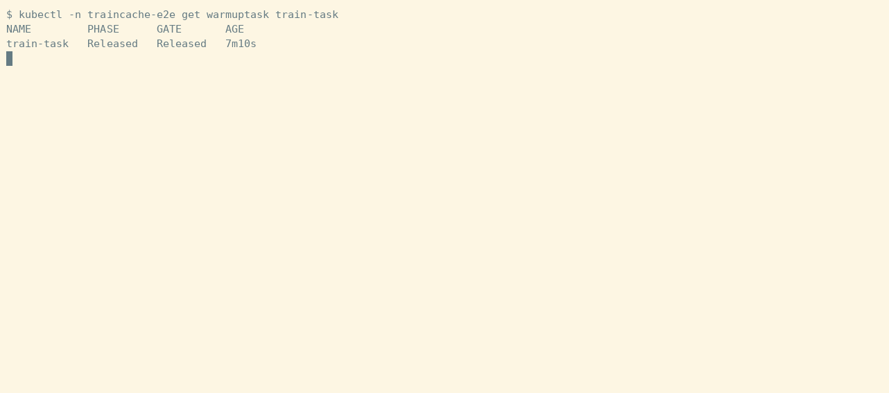
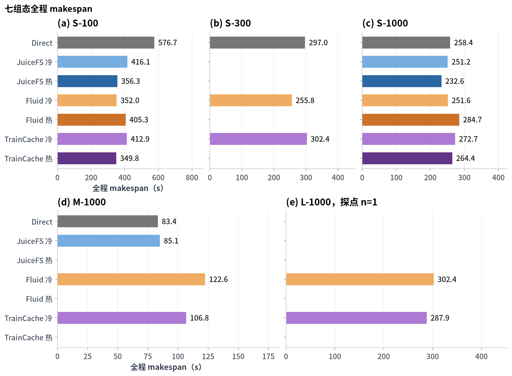
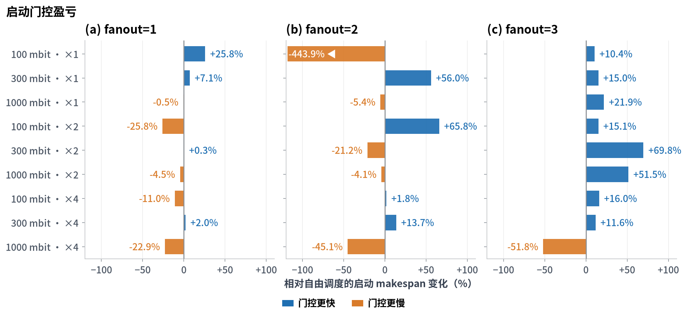
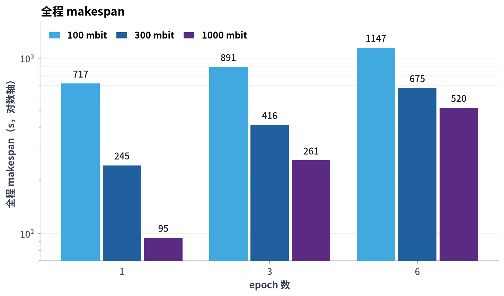
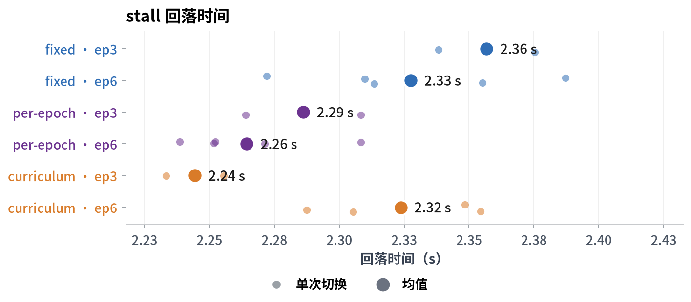
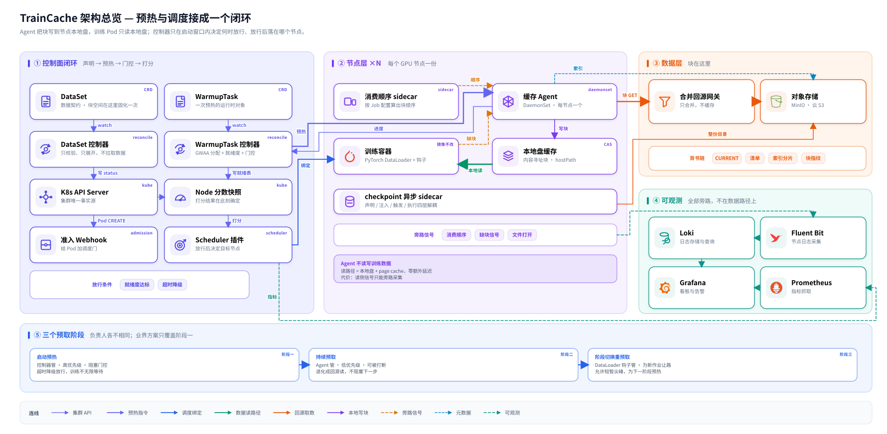

[English](README.md) | 简体中文

# TrainCache

TrainCache 运行在 Kubernetes 上。Pod 调度前，它把数据集的块拉到节点本地盘，用预热进度决定 Pod 调度到哪个节点，训练中按数据消费顺序持续预取后续块。

[](https://github.com/TheWor1d877/TrainCache/actions/workflows/verify.yml)    


```bash
make e2e    # 建 kind 集群、加载镜像、跑六项断言
```



*图 1：`make e2e` 跑完后查询资源。WarmupTask 已 Released，两个训练 Pod 落在带 `traincache.io/s3-access=true` 的节点，Pod 注释里的 `node-scores` 为 100。*

## 背景

Fluid 1.1.0-alpha.9 的 DataLoad 与调度互不影响：Pod 创建后立刻进入调度，预热进度不参与选点（[现勘报告](docs/3-field-survey.md) §2.2）。JuiceFS 社区版只提供本地缓存，分布式缓存组、IORPC 与 RDMA 属于企业版（同上 §0）。训练 Pod 从 epoch 0 跑到结束常驻同一节点，epoch 与 shuffle 切换发生在 Pod 内，不触发重新调度；启动阶段写入节点本地盘的块在后续 epoch 不再命中，也没有组件提前拉取。

## 功能

- 提交 `WarmupTask` 后，webhook 给匹配的训练 Pod 注入 `traincache.io/warmup` SchedulingGate，Pod 停在 Pending；controller 按 Pod 分片向候选节点拉块，块级就绪度达到门控阈值 `M` 后移除 gate。
- 超过 `t_max` 仍未就绪，controller 移除 gate，Pod 走默认调度放行（[实验协议](docs/4.4-experiment-protocol.md) §2）。
- scheduler 插件读 Pod 注释 `traincache.io/node-scores`，按全局位置衰减后的就绪度给候选节点打分，选分数最高的节点。
- Pod 调度到节点后，agentd 按训练实际消费顺序预取后续块；epoch、shuffle、curriculum 切换事件到达时，按新顺序继续预取（`agent/ordersrc/`）。
- 每次预热到候选节点的字节记入 `startup_warmup_bytes`，持续预取的字节记入 `sustained_prefetch_bytes`，同一格的所有组态共用这套口径（[实验协议](docs/4.4-experiment-protocol.md) §1.5）。

## 快速开始

前置条件：Kubernetes 1.28+ 集群、kubectl、openssl、一个 S3 兼容桶。发布物为 linux/amd64，e2e 在 `kindest/node:v1.37.0` 上通过。

**1. 控制面安装。** 镜像按 digest 固定：

```bash
curl -LO https://github.com/TheWor1d877/TrainCache/releases/download/v0.4.1/install.yaml
kubectl apply -f install.yaml
```

**2. Webhook 证书。** 清单里的 `caBundle` 为空，需要生成服务端证书并回填：

```bash
NS=traincache; SVC=traincache-webhook
TLS=$(mktemp -d)
openssl req -x509 -newkey rsa:2048 -nodes -days 365 -keyout "$TLS/ca.key" -out "$TLS/ca.crt" -subj "/CN=traincache-ca"
openssl req -newkey rsa:2048 -nodes -keyout "$TLS/tls.key" -out "$TLS/tls.csr" -subj "/CN=$SVC"
printf 'subjectAltName=DNS:%s,DNS:%s.%s.svc.cluster.local\n' "$SVC" "$SVC" "$NS" >"$TLS/san.ext"
openssl x509 -req -in "$TLS/tls.csr" -CA "$TLS/ca.crt" -CAkey "$TLS/ca.key" -CAcreateserial -out "$TLS/tls.crt" -days 365 -extfile "$TLS/san.ext"
kubectl -n "$NS" create secret tls traincache-webhook-tls --cert="$TLS/tls.crt" --key="$TLS/tls.key"
kubectl patch mutatingwebhookconfiguration traincache-pod-warmup --type=json \
  -p "[{\"op\":\"replace\",\"path\":\"/webhooks/0/clientConfig/caBundle\",\"value\":\"$(base64 -w0 "$TLS/ca.crt")\"}]"
```

证书有效期为 365 天，SAN 覆盖 Service 名与 namespace 内的 DNS。

**3. 桶与凭据。** `DataSet.spec` 写 `endpoint`（不带 scheme）、`bucket`、`secretRef`；Secret 的字段是 `accessKey` 与 `secretKey`，与 DataSet 同 namespace。桶的接入方式见[云对象存储部署指南](docs/0-cloud-object-storage-deployment.md)。

**4. 控制面验证。**

```bash
kubectl -n traincache rollout status deploy/traincache-controller-manager --timeout=300s
kubectl -n traincache get pods
```

```text
NAME                                             READY   STATUS
traincache-agentd-<hash>                         1/1     Running
traincache-controller-manager-<hash>             1/1     Running
traincache-gateway-<hash>                        1/1     Running
traincache-webhook-<hash>                        1/1     Running
```

scheduler 运行在 `kube-system`，用 `kubectl -n kube-system rollout status deploy/traincache-scheduler` 查看。训练 Pod 的样例清单是 `agent/deploy/train-pod.yaml`，`DataSet` 与 `WarmupTask` 的字段见 [4.3 启动与实验](docs/4.3-startup-and-experiments.md)。

卸载：

```bash
kubectl delete -f install.yaml
```

## 实验结果

七种组态包括 direct 直读、JuiceFS 冷/热、Fluid 冷/热与 TrainCache 冷/热，同一负载形态各跑 3 次。表中为均值，bootstrap 95% 置信区间放在 CSV 的 `ci_low` 与 `ci_high` 列。数据版本 `v0.4.0`，图上用到的聚合值见 [`compare_total_v0.4.0.csv`](docs/assets/data/compare_total_v0.4.0.csv)。L-1000 只有 1 次运行。

| 格 | direct | Fluid 冷 | TrainCache 冷 | TrainCache 热 | n |
|---|---:|---:|---:|---:|---:|
| S-100 | 576.7 | 352.0 | 412.9 | 349.8 | 3 |
| S-300 | 297.0 | 255.8 | 302.4 | — | 3 |
| S-1000 | 258.4 | 251.6 | 272.7 | 264.4 | 3 |
| M-1000 | 83.4 | 122.6 | 106.8 | — | 3 |
| L-1000 | — | 302.4 | 287.9 | — | 1 |

- S-100（100 mbit、2 GiB 数据）：TrainCache 冷比 direct 少 163.7 s（28.4%），Fluid 冷比 TrainCache 冷少 60.9 s；TrainCache 热 349.8 s。
- 同格 stall 占比从 direct 的 52.9% 降到 TrainCache 冷的 0.1%。冷启动预热花了 124.3 s，总时长仍低于 direct。
- 1000 mbit 下门控预热是净开销：S-1000 从 258.4 s 涨到 272.7 s（5.6%），M-1000 从 83.4 s 涨到 106.8 s（28.1%）。
- 六个格子切换后 stall 回落时间在 2.24 至 2.36 s 之间，最大差 0.11 s（4.9%），低于协议规定的 20% 判据。



*图 2：五个格子、七种组态的全程 makespan，柱长为该组均值，越短越好。*



*图 3：启动门控相对自由调度的 makespan 变化，按 fanout 分三面。右向蓝柱表示门控更快，左向橙柱表示门控更慢；−443.9% 的格子截断到轴端并用 `◀` 标出真实值。*



*图 4：三档带宽下 1、3、6 个 epoch 的全程 makespan，柱顶标实测值，纵轴为对数刻度。*



*图 5：六个格子的 shuffle × epoch 切换后的 stall 回落时间。小点是单次切换事件，大点是均值，右侧标数值。*

## 架构



*图 6：控制面、节点面与对象存储。*

控制面下发预热任务、门控释放与节点打分，不进入数据路径。agentd 常驻每个节点，把块写到节点本地盘；训练 Pod 以 hostPath 只读挂载该目录，读取不经过 agentd。读侧信号由 DataLoader 钩子与 inotify 旁路采集。

块的来源有两种。`gatewayEndpoint` 为空时 agentd 直连对象存储；配置后 agentd 把块 GET 交给网关，网关把重复请求合并成一次回源。网关是单副本 Deployment，默认监听 `:9413`，契约与取舍见 [9.1 design](docs/9.1-design.md)。

## 上游关系

Fluid 1.1.0-alpha.9 与 JuiceFS CE 1.3.0 在 kind 集群里部署并测得基准数据，作为七种组态中的对照组（[现勘报告](docs/3-field-survey.md)、[4.2 juicefs 与 fluid](docs/4.2-juicefs-and-fluid.md)）。`DataSet` 与 `Runtime` 的命名、nodeAffinity 注入方式参考 Fluid。块级就绪度在 `controller/cmd/controller-manager`，SchedulingGate 注入在 `controller/cmd/webhook`，节点打分在 `controller/cmd/scheduler`，预取在 `agent/cmd/agentd`。上游代码未内嵌，两个项目均为 Apache-2.0：[fluid-cloudnative/fluid](https://github.com/fluid-cloudnative/fluid)、[juicedata/juicefs](https://github.com/juicedata/juicefs)。

## 已知限制

- 实验只覆盖 kind 五节点集群、2/8/32 GiB 三档数据集与 1 GiB 缓存；跨集群、多租户与 GPU 训练未测。
- 1000 mbit 下门控预热增加总时长：M-1000 慢 28.1%，S-1000 慢 5.6%。门控只在带宽受限且工作集超过缓存时有效。
- 读路径要求节点有本地盘。agentd 不在读 I/O 路径上，读侧信号靠旁路采集，精度受钩子覆盖率影响。
- 持续预取 lookahead 16 与 32 相对 8 的全程收益为 −7.4% 与 −17.3%（n=2），各 lookahead 档位都没有正收益。
- 网关单副本，多副本扩容未实现。
- 不调度 epoch。epoch、shuffle 与 curriculum 切换只改节点内预取顺序，不进入调度路径。

## 构建与测试

```bash
make verify           # 三个模块的 build、vet、go test -race 与 gofmt
make verify-metadata  # 版本口径、镜像名、文档相对链接
hack/build-images.sh  # 开发镜像（:dev）
make e2e              # kind 集群中的六项断言
```

`make e2e` 覆盖 webhook 注入 gate、预热进度与 gate 释放、Pod 绑定到自定义 scheduler、`node-scores` 注释解析、scheduler 消费注释、`NodeDeviation` 事件六项。CI 的 `verify` 工作流跑同样的单元测试与 MinIO 集成测试。

## 文档

`docs/` 下的文档用中文撰写。

| 文档 | 内容 |
|---|---|
| [1 TrainCache 介绍与背景](docs/1-introduction-and-background.md) | 问题定义、外部事实、与 Fluid/JuiceFS 的定位差异 |
| [2 TrainCache 三层架构](docs/2-three-layer-architecture.md) | 控制面、节点面、数据源的分工与数据面约定 |
| [3 现勘报告](docs/3-field-survey.md) | Fluid/JuiceFS 的机制现勘与缺口证据 |
| [4.0 bench 文档导览](docs/4.0-bench-guide.md) | 4.1–4.6 的分工与常驻命令 |
| [4.1 bench 装置与规则](docs/4.1-bench-setup-and-rules.md) | 装置构成、参数与数据落点 |
| [4.2 juicefs 与 fluid](docs/4.2-juicefs-and-fluid.md) | 对照组的镜像、起组、预热、运行与拆组 |
| [4.3 TrainCache 启动与实验](docs/4.3-startup-and-experiments.md) | 镜像构建、控制面拉起、实验族启动 |
| [4.4 实验协议](docs/4.4-experiment-protocol.md) | 预注册假设、口径、条件矩阵与判据 |
| [4.5 实验口径决策](docs/4.5-metric-decisions.md) | 已定的验收判据与实验口径 |
| [4.6 实验版本记录](docs/4.6-experiment-version-log.md) | 版本 × 实验族矩阵与产物路径 |
| [5.x 缓存核心库](docs/5.1-design.md) | 设计要求、计划、决策与测试 |
| [6.x Agent 服务化](docs/6.1-design.md) | 节点面的接口与决策 |
| [7.x Controller 与 Scheduler](docs/7.1-design.md) | 控制面的接口与决策 |
| [8.x 日志与监控](docs/8.1-design.md) | 指标、日志契约与使用说明 |
| [9.x 合并回源网关](docs/9.1-design.md) | 网关的接口契约、决策与测试 |
| [发布约束](docs/RELEASE-CONSTRAINTS.md) | 版本、镜像、发布物与 CI 口径 |

## License

Apache-2.0，见 [LICENSE](LICENSE)。
