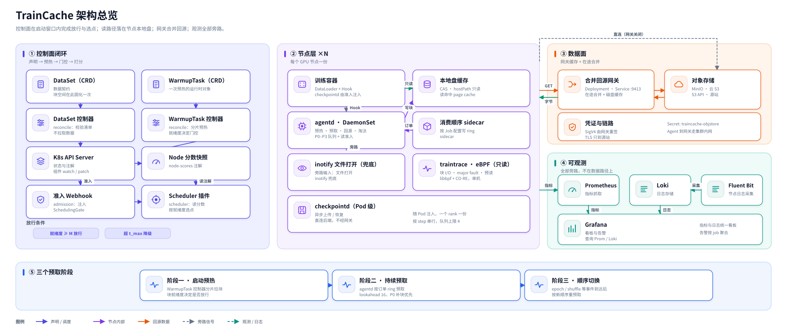
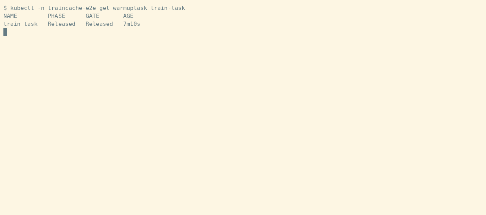
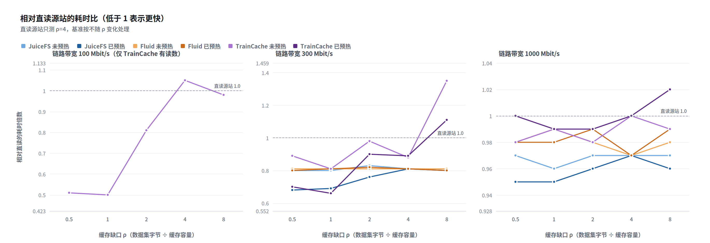
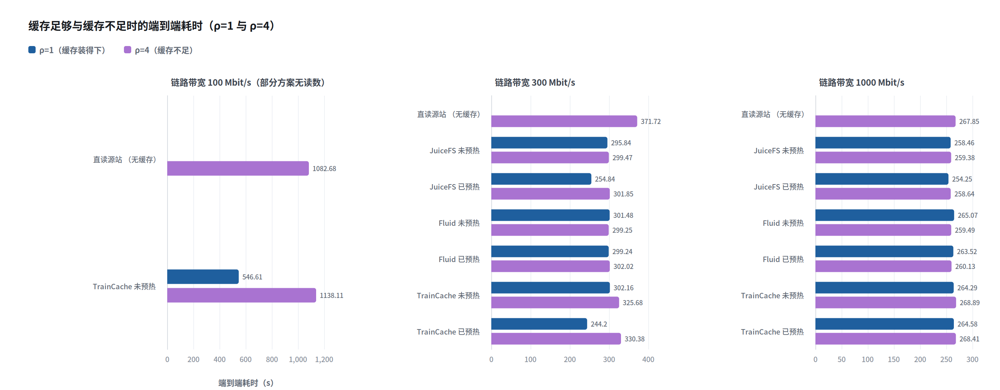
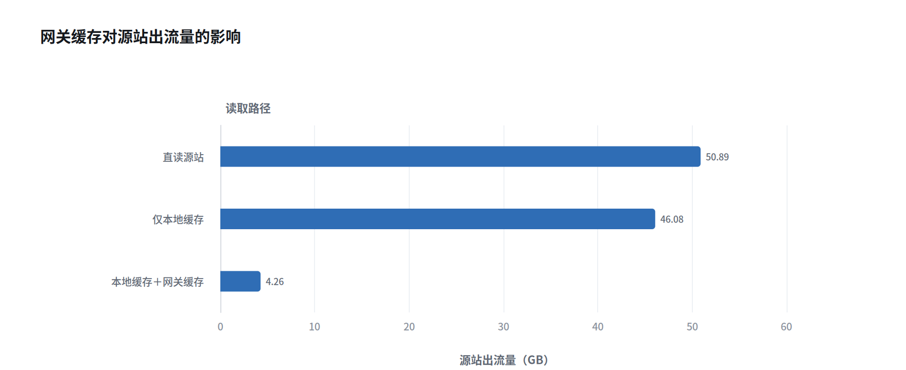
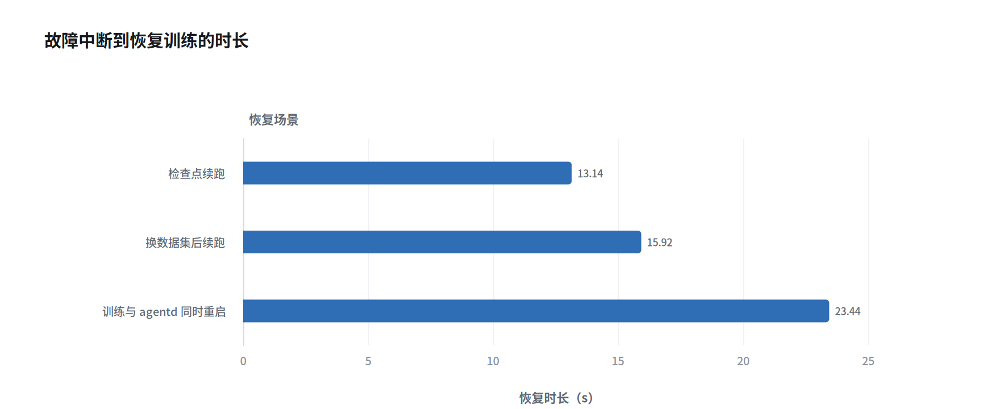

[English](README.md) | 简体中文

# TrainCache

TrainCache 运行在 Kubernetes 上。Pod 调度前，它把数据集的块拉到节点本地盘，用预热进度决定 Pod 调度到哪个节点，训练中按数据消费顺序持续预取后续块。

基准图表：[GitHub Pages](https://thewor1d877.github.io/TrainCache/index-zh.html)。

[](https://github.com/TheWor1d877/TrainCache/actions/workflows/verify.yml)    

<picture><source media="(prefers-color-scheme: dark)" srcset="docs/assets/logo/traincache-lockup-dark.svg"></picture>



*图 1：控制面、节点面、数据面与可观测。网关合并在途请求并缓存块；traintrace 用 eBPF 观测块 I/O；checkpointd 以 Pod 级 sidecar 运行。*

```bash
make e2e    # 建 kind 集群、加载镜像、跑六项断言
```



*图 2：`make e2e` 跑完后查询资源。WarmupTask 已 Released，两个训练 Pod 落在带 `traincache.io/s3-access=true` 的节点，Pod 注释里的 `node-scores` 为 100。*

## 背景

Fluid 1.1.0-alpha.9 的 DataLoad 与调度互不影响：Pod 创建后立刻进入调度，预热进度不参与选点（[现勘报告](docs/3-field-survey.md) 的 webhook 注入前后 diff 为零一节）。JuiceFS 社区版只提供本地缓存，分布式缓存组、IORPC 与 RDMA 属于企业版（同文档的结论与缺口判定一节）。训练 Pod 从 epoch 0 跑到结束常驻同一节点，epoch 与 shuffle 切换发生在 Pod 内，不触发重新调度；启动阶段写入节点本地盘的块在后续 epoch 不再命中，也没有组件提前拉取。

## 适用场景

TrainCache 面向「数据要从远端拉、消费顺序能提前算出来、拉取带宽是瓶颈」的训练负载。它在 Pod 调度前把数据块拉到节点本地盘，用块级就绪度决定 Pod 落在哪个节点，训练中按消费顺序续拉后续块。

### 负载分类

| 负载类型 | 数据集总量 | 消费特征 | TrainCache 的位置 |
|---|---|---|---|
| 大规模预训练 | TB ~ PB 级 | 多数只消费一遍 | 劣势区：工作集装不进节点缓存，缓存复用比例低 |
| 中间训练、大规模微调 | 几百 GB ~ 几 TB | 多个实验、多个 epoch 反复消费 | 优势区 |
| 业务微调、领域训练 | 几 GB ~ 几百 GB | 反复迭代 | 优势区边缘：迭代带来的复用抵掉一部分系统固定开销 |
| 流式、在线数据 | 没有固定总量 | 消费顺序算不出来 | 不适用：顺序预排与门控都没有依据 |

### 优势区间的判据

四条同时成立时收益最大：

1. 数据要从远端拉。本地盘装不下整个工作集，或者冷启动时本地没有副本。
2. 消费顺序能提前算出来。epoch、shuffle seed、batch 大小在 Job 配置里已知。
3. 拉取带宽是瓶颈。直连数据源会让训练在读块时停顿。
4. 同一份数据被重复消费。多个 epoch、多个实验、各节点的冷启动都读它。

收益有两条路径：

- **复用**：数据集总量（口径：整个数据集的总字节数）落在每节点可用缓存空间（口径：每节点，按 8~12 TB 计）的几分之一到几倍区间，也就是几百 GB 到几 TB。节点缓存装得下大部分工作集，重复消费不必再回远端取。
- **重叠**：工作集超过节点缓存时，按消费顺序预取让下载与计算同时进行，收益在这里，缓存复用比例低。现有实验覆盖的是这条路径，实验规模见「已知限制」。

数据集总量再大一个数量级，重复消费比例下降，收益只剩顺序预取带来的重叠；再小一个数量级，Controller、门控、Agent、订单 sidecar 与钩子插桩的固定开销超过收益。

### 劣势区间的判据

- 单遍消费为主的大规模预训练：工作集装不进节点缓存，数据不重复消费，缓存复用比例低。
- 流式、在线数据：消费顺序算不出来，顺序预排与门控都没有依据。
- 本机已有数据副本：镜像里带了数据，或者同节点其它任务留下了可用缓存，预热是多余动作。
- 数据集总量远大于集群可用缓存空间：缓存只起流式缓冲的作用，复用比例趋近于零。

## 功能

- 提交 `WarmupTask` 后，webhook 给匹配的训练 Pod 注入 `traincache.io/warmup` SchedulingGate，Pod 停在 Pending；controller 按 Pod 分片向候选节点拉块，块级就绪度达到门控阈值 `M` 后移除 gate。
- 超过 `t_max` 仍未就绪，controller 移除 gate，Pod 走默认调度放行（[指标与决策](docs/4.3-bench-metrics-and-decisions.md)）。
- scheduler 插件读 Pod 注释 `traincache.io/node-scores`，按全局位置衰减后的就绪度给候选节点打分，选分数最高的节点。
- Pod 调度到节点后，agentd 按训练实际消费顺序预取后续块；epoch、shuffle、curriculum 切换事件到达时，按新顺序继续预取（`agent/ordersrc/`）。
- 每次预热到候选节点的字节记入 `startup_warmup_bytes`，持续预取的字节记入 `sustained_prefetch_bytes`，同一格的所有组态共用这套口径（[指标与决策](docs/4.3-bench-metrics-and-decisions.md) §2）。
- 配置 `gatewayEndpoint` 后，agentd 把块 GET 交给单副本网关。网关合并在途的重复请求；开启磁盘缓存后，错峰重复的块直接从网关盘返回。网关用自己的凭证重签 SigV4，并在到源站这一段终止 TLS（[9.x 网关](docs/9.1-design.md)）。
- 带 `traincache.io/checkpoint` 标签的 Pod 在准入时注入异步 checkpoint sidecar。它在 Pod 卷与后端之间搬运 checkpoint 目录，流量不经过网关（[10.x checkpoint](docs/10.1-design.md)）。
- `traintrace` 是只读 eBPF 二进制，按 cgroup 与进程记录块 I/O 延迟、major fault 与无效预读，每轮写出结构化指标文件（[11.x eBPF](docs/11.0-eBPF-observability-tools.md)）。

## 快速开始

前置条件：Kubernetes 1.28+ 集群、kubectl、openssl、一个 S3 兼容桶。发布物为 linux/amd64，e2e 在 `kindest/node:v1.37.0` 上通过。

**1. 控制面安装。** 镜像按 digest 固定：

```bash
curl -LO https://github.com/TheWor1d877/TrainCache/releases/download/v0.9.3/install.yaml
kubectl apply -f install.yaml
```

**2. Webhook 证书。** 清单里的 `caBundle` 为空，需要生成服务端证书并回填：

```bash
NS=traincache; SVC=traincache-webhook
TLS=$(mktemp -d)
openssl req -x509 -newkey rsa:2048 -nodes -days 365 -keyout "$TLS/ca.key" -out "$TLS/ca.crt" -subj "/CN=traincache-ca"
openssl req -newkey rsa:2048 -nodes -keyout "$TLS/tls.key" -out "$TLS/tls.csr" -subj "/CN=$SVC"
printf 'subjectAltName=DNS:%s,DNS:%s.%s.svc.cluster.local\n' "$SVC" "$SVC" "$NS" >"$TLS/san.ext"
openssl x509 -req -in "$TLS/tls.csr" -CA "$TLS/ca.crt" -CAkey "$TLS/ca.key" -CAcreateserial -out "$TLS/tls.crt" -days 365 -extfile "$TLS/san.ext"
kubectl -n "$NS" create secret tls traincache-webhook-tls --cert="$TLS/tls.crt" --key="$TLS/tls.key"
kubectl patch mutatingwebhookconfiguration traincache-pod-warmup --type=strategic \
  -p "{\"webhooks\":[{\"name\":\"pods.traincache.io\",\"clientConfig\":{\"caBundle\":\"$(base64 -w0 "$TLS/ca.crt")\"}},{\"name\":\"pods-checkpoint.traincache.io\",\"clientConfig\":{\"caBundle\":\"$(base64 -w0 "$TLS/ca.crt")\"}}]}"
```

证书有效期为 365 天，SAN 覆盖 Service 名与 namespace 内的 DNS。CA 要写进两条 webhook 条目：checkpoint 条目的 `failurePolicy` 是 `Fail`，`caBundle` 为空时带 `traincache.io/checkpoint` 标签（值为同 namespace 的 ConfigMap 名）的 Pod 会被准入拒绝。

用 Helm chart 时，Secret 用同样命令创建，CA 在安装时通过 `--set webhook.caBundle` 传入。chart 会同时写进两条规则，不需要再 patch：

```bash
helm install traincache ./chart/traincache -n traincache --create-namespace \
  --set webhook.caBundle="$(base64 -w0 "$TLS/ca.crt")" \
  --set config.objstoreEndpoint=<endpoint> --set config.objstoreBucket=<bucket>
```

chart 的前置动作与全部 values 见 [chart/traincache/README.md](chart/traincache/README.md)。

**3. 桶与凭据。** `DataSet.spec` 写 `endpoint`（不带 scheme）、`bucket`、`secretRef`；Secret 的字段是 `accessKey` 与 `secretKey`，与 DataSet 同 namespace。桶的接入方式见[云对象存储部署指南](docs/0-cloud-object-storage-deployment.md)。

**4. 控制面验证。**

```bash
kubectl -n traincache rollout status deploy/traincache-controller-manager --timeout=300s
kubectl -n traincache get pods
```

```text
NAME                                             READY   STATUS
traincache-agentd-<hash>                         1/1     Running
traincache-controller-manager-<hash>             1/1     Running
traincache-gateway-<hash>                        1/1     Running
traincache-webhook-<hash>                        1/1     Running
```

scheduler 运行在 `kube-system`，用 `kubectl -n kube-system rollout status deploy/traincache-scheduler` 查看。训练 Pod 的样例清单是 `agent/deploy/train-pod.yaml`，`DataSet` 与 `WarmupTask` 的字段见 [4.4 操作手册](docs/4.4-bench-runbook.md)。

卸载：

```bash
kubectl delete -f install.yaml
```

Helm 安装的卸载命令是 `helm uninstall traincache -n traincache`。

## 实验结果

TrainCache v0.9.3 的基准测试在 kind 集群上覆盖 11 个实验族：145 个格子、432 条有效采样，每格 3 轮（e2e 每场景 2 轮）。对照族覆盖直读源站、JuiceFS 与 Fluid 的冷/热组态、TrainCache 的冷/热组态，链路带宽取 100、300、1000 Mbit/s，ρ 从 0.5 到 8，ρ 为数据集字节数除以单节点缓存容量。数值为格均值；每格汇总文件在 `docs/assets/data/bench-v0.9.3/`。图与交互页由 `python3 bench/experiments/plot_echarts.py` 生成，全部 20 张图与图下说明在[图表页](https://thewor1d877.github.io/TrainCache/index-zh.html)。

结果在 ρ=1 处分开。ρ≤1 时节点缓存装得下工作集，收益来自复用；ρ>1 后命中率降到 0.32 以下，耗时由回源路径决定。



*图 3：每种组态在同一带宽下除以直读源站的耗时，低于虚线 1.0 表示更快。100 Mbit/s、ρ≤1 时 TrainCache 用 547 s，直读为 1083 s；300 Mbit/s 已预热组比 Fluid 已预热少 55 s；300 Mbit/s、ρ=8 的未预热组比直读慢 35%。直读只测 ρ=4，按不随 ρ 变化处理。*



*图 4：同一带宽下 ρ=1 与 ρ=4 的对比。100 Mbit/s 的未预热组比直读快 49%；300 Mbit/s 已预热组比 Fluid 已预热快 18%。ρ=4 时 300 Mbit/s 未预热比 Fluid 未预热慢 9%，100 Mbit/s 比直读慢 5%。100 Mbit/s 分面没有 Fluid 与 JuiceFS 读数。*

其余族在同一装置上每次只改一个子系统。



*图 5：源站出流量依次为 50.9 GB（直读源站）、46.1 GB（仅本地缓存）与 4.3 GB（本地缓存加网关）。网关把重复块请求合并成一次回源，出流量减少 92%。*



*图 6：检查点续跑 13.1–13.2 s，换数据集后续跑 14.3–17.6 s，训练与 agentd 同时重启 22.0–24.9 s。恢复窗口内读错误为 0。*

- 淘汰：ρ=1 三者 76–79 s，差异在噪声内；ρ=8 热度优先 132 s、LRU 143 s、LFU 148 s。
- 预取：前瞻 8 最优（ρ=8 时 273 s），前瞻 32 最差（337–359 s）；副本数从 1 增到 3 没有收益。
- 预热门控：ρ=1、等待上限 60 s 时把启动从 32.8 s 降到 3.4 s；ρ=8 时门控多花 0.3–2.0 s。
- 顺序切换：ρ=1 四种方式都在 2.3 s；ρ=8 升到 6.5–11.4 s。
- 两个任务共享缓存：命中率 0.39–0.42；同节点部署 408–412 s，跨节点 413–418 s。
- 并行连接：三种受限链路下，4 路并行的耗时比分别为 2.7×、4.3×、3.9×。
- 混沌：六种故障修复后全部 PASS。

## 已知限制

300 Mbit/s、ρ>1 的格子里 TrainCache 慢于 Fluid 与 JuiceFS：命中率在 ρ=4 降到 0.09–0.13、ρ=8 降到 0.04–0.05，agentd 打开的回源连接少，也不合并不同 Pod 的重复块请求，回源路径填不满链路。合并重复读的网关单独成族测量，对照族未开启。这一区间在当前设计的目标复用区之外；提高 agentd 的回源并发、在对照族里开启网关属于后续工作。

## 架构

控制面下发预热任务、门控释放与节点打分，不进入数据路径。agentd 常驻每个节点，把块写到节点本地盘；训练 Pod 以 hostPath 只读挂载该目录，读取不经过 agentd。读侧信号由 DataLoader 钩子与 inotify 旁路采集。

块的来源有两种。`gatewayEndpoint` 为空时 agentd 直连对象存储；配置后 agentd 把块 GET 交给网关，网关把重复请求合并成一次回源。网关是单副本 Deployment，默认监听 `:9413`，契约与取舍见 [9.1 design](docs/9.1-design.md)。

## 上游关系

Fluid 1.1.0-alpha.9 与 JuiceFS CE 1.3.0 在 kind 集群里部署并测得基准数据，作为七种组态中的对照组（[现勘报告](docs/3-field-survey.md)、[4.1 装置](docs/4.1-bench-apparatus.md)）。`DataSet` 与 `Runtime` 的命名、nodeAffinity 注入方式参考 Fluid。块级就绪度在 `controller/cmd/controller-manager`，SchedulingGate 注入在 `controller/cmd/webhook`，节点打分在 `controller/cmd/scheduler`，预取在 `agent/cmd/agentd`。上游代码未内嵌，两个项目均为 Apache-2.0：[fluid-cloudnative/fluid](https://github.com/fluid-cloudnative/fluid)、[juicedata/juicefs](https://github.com/juicedata/juicefs)。

## 构建与测试

```bash
make verify           # 三个模块的 build、vet、go test -race 与 gofmt
make verify-metadata  # 版本口径、镜像名、文档相对链接
hack/build-images.sh  # 开发镜像（tag 与清单一致）
make e2e              # kind 集群中的六项断言
```

`make e2e` 覆盖 webhook 注入 gate、预热进度与 gate 释放、Pod 绑定到自定义 scheduler、`node-scores` 注释解析、scheduler 消费注释、`NodeDeviation` 事件六项。CI 的 `verify` 工作流跑同样的单元测试与 MinIO 集成测试。

## 文档

`docs/` 下的文档用中文撰写。

| 文档 | 内容 |
|---|---|
| [0 云对象存储部署](docs/0-cloud-object-storage-deployment.md) | S3 兼容桶的接入与凭据配置 |
| [1 TrainCache 介绍与背景](docs/1-introduction-and-background.md) | 问题定义、外部事实、与 Fluid/JuiceFS 的定位差异 |
| [2 TrainCache 三层架构](docs/2-three-layer-architecture.md) | 控制面、节点面、数据源的分工与数据面约定 |
| [3 现勘报告](docs/3-field-survey.md) | Fluid/JuiceFS 的机制现勘与缺口证据 |
| [4.1 装置与变量空间](docs/4.1-bench-apparatus.md) | 装置构成、ρ 阶梯、参数、数据生成与落点 |
| [4.2 实验族与格子](docs/4.2-bench-families.md) | 十一个族的轴与格子、COND 契约、机时账 |
| [4.3 指标与决策](docs/4.3-bench-metrics-and-decisions.md) | 指标算式、判据阈值、D 号决策 |
| [4.4 操作手册](docs/4.4-bench-runbook.md) | 环境准备、拉起、数据准备、跑族、排障、产物 |
| [5.x 缓存核心库](docs/5.1-design.md) | 设计要求、计划、决策与测试 |
| [6.x Agent 服务化](docs/6.1-design.md) | 节点面的接口与决策 |
| [7.x Controller 与 Scheduler](docs/7.1-design.md) | 控制面的接口与决策 |
| [8.x 日志与监控](docs/8.1-design.md) | 指标、日志契约与使用说明 |
| [9.x 合并回源网关](docs/9.1-design.md) | 网关的接口契约、决策与测试 |
| [10.x checkpoint sidecar](docs/10.1-design.md) | 注入、保存与恢复流程、后端插件 |
| [11.x eBPF 观测](docs/11.0-eBPF-observability-tools.md) | traintrace 探针、指标契约与 bench 集成 |
| [CLI 接口](docs/CLI-INTERFACE.md) | 命令集、参数与退出码 |
| [参数配置](docs/PARAMETER-CONFIGURATION.md) | DataSet、WarmupTask 与各组件的参数 |
| [发布约束](docs/RELEASE-CONSTRAINTS.md) | 版本、镜像、发布物与 CI 口径 |

## License

Apache-2.0，见 [LICENSE](LICENSE)。
