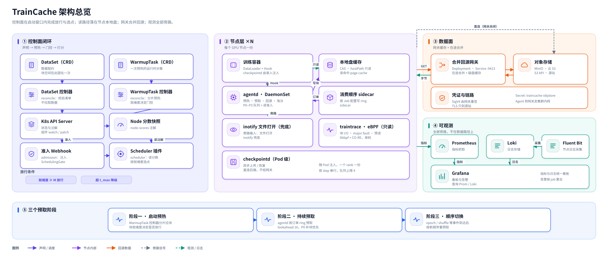

# TrainCache 项目分析

结项报告 · 数据版本 v0.9.3 · 2026-11-19

## 结论摘要

TrainCache 在 Kubernetes 上预热训练数据，预热进度同时作为 Pod 放行条件与节点打分输入。训练 Pod 以 hostPath 只读挂载节点缓存目录，读请求由本地盘与 page cache 承载；消费顺序 sidecar 把训练接下来要读的块序交给 agentd；网关合并不同 Pod 的重复回源。TrainCache 只处理训练数据读取，不提供通用文件系统接口。

ρ≤1 的格子里，节点缓存装得下工作集：100 Mbit/s 下直读源站 1083 s，TrainCache 547 s，约 2.0×；300 Mbit/s 已预热组 244 s，Fluid 已预热组 299 s；预热门控把启动等待从 32.8 s 降到 3.4 s；网关把一次作业的耗时从 1449 s 降到 330 s，源站出流量从 50.9 GB 降到 4.3 GB（−92%）；故障恢复到续训 13–25 s，恢复窗口内读错误为 0。这些收益出自预热、门控、调度与本地读连成的一条控制链。

ρ>1 的格子里，节点缓存装不下工作集，耗时由未命中路径决定。300 Mbit/s、ρ=8 的未预热组 503 s，直读源站 372 s，慢 35%，Fluid 与 JuiceFS 约 300 s。agentd 打开的回源连接少，不同 Pod 的重复块请求不合并；命中率降到 0.04–0.05 后，读请求回到订单调度，回源并发低于训练进程直读。

按定义场景内有效验收，结论成立。按对比表每一行都占优验收，结论不成立。差距集中在缓存不足时的回源、通用文件语义、跨节点缓存与社区成熟度，四处各自需要单独投入。

## 1 项目定位

调度发生在数据就绪之前。Fluid 1.1.0-alpha.9 的 DataLoad 与调度互不影响，Pod 创建后立即进入调度，预热进度不参与选点。

数据顺序在训练过程中会变。epoch 与 shuffle 发生在 Pod 内，不触发重新调度；启动阶段写入节点本地盘的块，在后续 epoch 不再命中，也没有组件提前拉取。

TrainCache 用一条控制链连接预热、门控、打分与预取，热读走节点本地盘。

- 控制面：DataSet / WarmupTask CRD、两个控制器、准入 Webhook、调度插件。
- 节点面：agentd、本地盘缓存（CAS 与 page cache）、消费顺序 sidecar、DataLoader 钩子与 inotify 旁路、checkpointd、traintrace。
- 数据面：可选的合并回源网关与对象存储。
- 可观测：Prometheus、Loki、Fluent Bit、Grafana，外加单机 eBPF 工具。

数据路径的取舍落在训练 Pod 这一侧：hostPath 只读挂载缓存目录，读请求不经过 agentd，也不经过 FUSE；agentd 只写块、回源、预取与淘汰。命中时读路径只有本地盘与 page cache；未命中时请求回到 agentd 的订单调度，回源并发受订单与预取窗口约束。

## 2 实验方法与边界

数据来自 TrainCache v0.9.3 的 11 个实验族：compare、gateway、evict、evict-mix、prefetch、warmup、switch、multiconsumer、e2e、rangepar、chaos。共 145 个格子、432 条有效采样，每格 3 轮（e2e 每场景 2 轮），数值为格均值。

对照族覆盖直读源站、JuiceFS CE 1.3.0 冷/热、Fluid 1.1.0-alpha.9 冷/热、TrainCache 冷/热；链路带宽 100 / 300 / 1000 Mbit/s，ρ 从 0.5 到 8。ρ 是数据集字节数除以单节点缓存容量，ρ≤1 表示缓存装得下工作集，ρ>1 表示装不下。

结论受六条边界约束：

- 数据集 4 GiB、3 个 epoch、单 reader。复用收益的上限是三轮变一轮，实测约 2×，这一数字对应本装置，不代表缓存系统在真实大训练上的上限。
- 1000 Mbit/s 下四种组态都在 254–273 s，stall 接近 0，瓶颈是计算，这一档没有区分度。
- 100 Mbit/s 分面只有 TrainCache 未预热组与 direct，没有 Fluid 与 JuiceFS；完整三方对照只在 300 与 1000 Mbit/s 成立。
- direct 只测 ρ=4，其他 ρ 的直读基准按不随 ρ 变化处理。
- 300 Mbit/s、ρ>1 的回源并发与请求合并没有补做实验，这一格作为已知限制结项。
- 对照族的两组 TrainCache 组态都不配置 gatewayEndpoint。网关的合并与磁盘缓存收益在 gateway 族单独测量；在对照族开启网关，会把网关磁盘缓存叠加到节点缓存上，ρ>1 的耗时差无法归到单一变量。

## 3 关键结果

### 3.1 复用区

| 场景 | TrainCache | 对照 | 结论 |
|---|---:|---:|---|
| 100 Mbit/s、ρ=1 | 547 s（未预热） | 直读 1083 s | 约 2.0× |
| 300 Mbit/s、ρ=1 | 244 s（已预热） | Fluid 已预热 299 s | 快 18% |
| 300 Mbit/s、ρ=1 | 302 s（未预热） | Fluid 未预热 302 s | 持平 |
| 1000 Mbit/s、全程 | 263–273 s | 254–273 s | 计算受限，慢 2–5% |

命中率在 ρ≤1 为 0.96–1.00，ρ=4 降到 0.09–0.13，ρ=8 降到 0.04–0.05。收益随命中率同向变化，复用区的时间差对应真实命中。

### 3.2 退化边界

| 场景 | TrainCache | 对照 | 结论 |
|---|---:|---:|---|
| 300 Mbit/s、ρ=4 | 326 s（未预热） | Fluid 未预热 299 s；直读 372 s | 比 Fluid 慢 9%，比直读快 12% |
| 300 Mbit/s、ρ=8 | 503 s（未预热） | 直读 372 s；Fluid/JuiceFS 约 300 s | 比直读慢 35% |
| 300 Mbit/s、ρ=8 | 413 s（已预热） | 直读 372 s | 仍慢于直读 |
| 100 Mbit/s、ρ=4 | 1138 s（未预热） | 直读 1083 s | 慢 5% |

ρ>1 时，预热带进缓存的块在下一轮读取前就被淘汰，以 ρ=8、0.5 GB 缓存为例。预热与回源都记入耗时。未预热组比已预热组多出的时间，用于把装不下的块再搬一遍。

### 3.3 子系统

| 子系统 | 结果 | 说明 |
|---|---|---|
| 网关 | 1449 s → 1321 s → 330 s；出流量 50.9 → 46.1 → 4.3 GB | 合并回源与网关缓存把重复请求收成一次，出流量 −92% |
| 预热门控 | 32.8 s → 3.4 s（60 s 窗口）；10 s 窗口仅 29.3 s | 窗口足够长才有收益；ρ=8 时门控多 0.3–2.0 s |
| 持续预取 | 前瞻 8：273 s；前瞻 32：337–359 s；副本 1→3 无收益 | 预取窗口过大或副本过多会挤占回源带宽 |
| 淘汰 | ρ=8：热度 132 s、LRU 143 s、LFU 148 s；ρ=1：76–79 s | ρ=8 时热度策略最快，ρ=1 时三者无差异 |
| 顺序切换 | ρ=1：2.3 s；ρ=8：6.5–11.4 s | 顺序变化后的重预取是场景三的主要成本 |
| 多消费者 | 命中 0.39–0.42；同节点 408–412 s，跨节点 413–418 s | 同节点与跨节点部署的耗时差 1–3% |
| 故障恢复 | 13.1–13.2 s / 14.3–17.6 s / 22.0–24.9 s | 检查点续跑、换数据集、训练与 agentd 同时重启；读错误 0 |
| 并行下载 | 2.7× / 4.3× / 3.9× | 单连接限速或高 RTT 下有效；不限速时与单连接持平 |
| 混沌 | 六种故障修复后全部 PASS | 故障语义以 PASS/FAIL 判定，不出图 |

## 4 优点

1. 预热进度接入调度决策。预热进度同时作为 Pod 放行条件与节点候选打分输入；三套组态中只有 TrainCache 这么做。
2. 热路径短。hostPath 只读挂载，训练进程直接读本地盘与 page cache，请求不经过 agentd、不经过 FUSE，也没有额外的网络转发。热读延迟与吞吐接近本地盘上限。
3. 顺序感知的预取。订单 ring 把训练接下来读的块显式交给 agentd；预取窗口、阶段切换重预取、P0 需求补块都有对应实现，不依赖通用 readahead 猜测。
4. 网关合并重复回源。同一个块被多个 Pod 请求时，网关只向源站取一次。4.4× 的作业耗时收益与 −92% 的出流量，在这批结果里最容易被生产环境观察到。
5. checkpoint 与恢复路径完整。异步 sidecar 覆盖保存、恢复、版本切换与训练和 agentd 同时重启三种情形，恢复窗口内读错误为 0。
6. eBPF 观测补上块级信息。traintrace 是只读单二进制，记录块 I/O 延迟、major fault 与无效预读，按 cgroup、pid、comm 归因，用来判断训练慢在数据还是计算。
7. Kubernetes 原生、S3 兼容、无厂商绑定。CRD 声明、准入注入、调度插件与标准 S3 接口都落在集群现有语义内，接入不需要更换存储协议。
8. 实验与数据留档完整。11 个实验族、432 条采样、e2e 与 chaos、双语图表页与每格数据，结论可以按格子复核。

## 5 缺点与风险

1. 缓存不足时没有独立回源路径。命中率归零后，每个块都要经过 agentd 的订单与预取调度；装置内同时回源的块数只有 1–3，重复请求不合并，回源并发低于训练进程直读。这是 300 Mbit/s、ρ>1 落后的主因。
2. 收益区间窄，实验规模又收窄了一层。4 GiB、3 epoch、单 reader 把复用收益锁在约 2×；1000 Mbit/s 下耗时由计算决定，节点缓存没有发挥空间。真实大训练可能落在 ρ≤1，本实验不能证明更大规模下的上限。
3. 通用性不足。接入需要 PyTorch DataLoader 钩子与 hostPath 挂载，不提供 POSIX 与 FUSE 语义；非 Python、非 DataLoader、随机读写或需要完整文件接口的应用无法直接使用。
4. 没有跨节点分布式缓存。每节点缓存独立，多消费者只能靠调度靠拢；同节点与跨节点部署的耗时差在 1–3%，跨节点共享缓存尚未实现。
5. 网关是单副本。当前为单副本 Deployment，网关故障时整条回源路径不可用；生产化需要多副本、选主或按数据集分片。
6. 参数敏感。前瞻过大、副本过多、预热门控窗口过短，都会让收益消失或转负；参数要按数据集、链路与消费顺序调整，缺少自适应策略。
7. 淘汰与混合访问没有稳定判据。混合访问下三种策略的存活率都低，差值落在测量波动内；ρ=8 时热度策略最快，ρ=1 时与 LRU、LFU 无差异，选择依据仍要按负载定。
8. 运维面偏重。六个镜像、两个 CRD、准入 Webhook、调度插件、agentd、网关、checkpoint 与 eBPF 工具，接入与升级成本高于一个 CSI 驱动或一个 Operator。
9. 部署与长期运行的经验不足。缺少多租户、QoS、配额、静态加密、审计与企业级支持；集成、文档与社区规模都小于 Fluid 与 JuiceFS。

## 6 与 Fluid 和 JuiceFS 的对比

### 6.1 能力矩阵

「独有」指在本报告涉及的三者范围内独有，不表示业界没有类似实现。

| 能力 | TrainCache | Fluid | JuiceFS | 归属 |
|---|---|---|---|---|
| 预热进度参与调度选点 | 有（门控 + 打分） | 无（DataLoad 不参与调度） | 无 | TrainCache 独有 |
| 就绪度门控放行 | 有 | 无 | 无 | TrainCache 独有 |
| 顺序感知持续预取 | 有（ring + 前瞻 + 阶段切换） | 部分（DataLoad 偏一次性） | 无（依赖 FUSE readahead） | TrainCache 独有 |
| 合并在途请求的网关 | 有（可选磁盘缓存） | 无 | 无 | TrainCache 独有 |
| checkpoint 异步 sidecar | 有 | 无 | 无 | TrainCache 独有 |
| eBPF 块级观测 | 有（traintrace） | 无 | 无 | TrainCache 独有 |
| 训练进程直读节点盘（无 FUSE / 代理） | 有（hostPath 直挂） | 部分（取决于 runtime） | 无（FUSE） | TrainCache 优势 |
| POSIX / FUSE 通用语义 | 无 | 有 | 有 | Fluid / JuiceFS 优势 |
| 跨节点分布式缓存 | 无 | 有（依赖 runtime） | 企业版 | Fluid / JuiceFS 优势 |
| 未命中回源并发与合并 | 部分（网关有，agentd 无） | 成熟 | 成熟 | Fluid / JuiceFS 优势 |
| 元数据加速 | 无 | 有（依赖 runtime） | 有（元数据引擎） | Fluid / JuiceFS 优势 |
| 框架 / 语言无关 | 无（PyTorch 钩子 + hostPath） | 有 | 有 | Fluid / JuiceFS 优势 |
| 网关 / 组件高可用 | 弱（网关单副本） | 较成熟 | 较成熟 / 企业版 | Fluid / JuiceFS 优势 |
| 多租户、QoS、配额、加密 | 弱 | 部分（依赖 runtime / 发行版） | 企业版更完整 | Fluid / JuiceFS 优势 |
| 部署复杂度 | 高（6 镜像 + CRD + Webhook + 调度器） | 中（Operator） | 中（CSI） | Fluid / JuiceFS 优势 |
| 社区与第三方集成 | 小 | CNCF 项目 | 大 | Fluid / JuiceFS 优势 |
| 缓存不足时的稳定性 | 退化明显 | 稳定 | 稳定 | Fluid / JuiceFS 优势 |
| 缓存充足时的复用收益 | 约 2× | 预热收益存在，但与调度解耦 | 本地缓存收益存在 | TrainCache 优势 |

按「是否独有」归纳：

- TrainCache 独有：预热进度参与调度选点、就绪度门控放行、订单驱动的持续预取与阶段切换、合并在途请求的网关、checkpoint 异步 sidecar、eBPF 块级观测。这些是本次对比范围内的实现差异，TrainCache 不替代通用文件系统。
- Fluid 的优势：数据集编排与多 runtime、分布式缓存、FUSE 与 POSIX 语义、元数据与缓存组、Operator、CNCF 社区与生产验证。
- JuiceFS 的优势：完整 POSIX 与 FUSE 语义、元数据引擎、客户端并发与 readahead、跨节点共享缓存（企业版）、大规模部署。
- 共同的限制：本次实验只覆盖 4 GiB、3 epoch、单 reader，不能代表几百 GB 到几 TB、多 reader、长周期训练的上限；TrainCache 的优势区间因此被压窄。

### 6.2 差距来源

四层因素叠加。

优化目标不同。TrainCache 优化缓存装得下、顺序可预测、需要调度联动的训练启动；Fluid 与 JuiceFS 优化任意应用、任意访问模式、缓存可能不足的通用数据访问。前者在定义场景里路径更短，后者在未命中与通用性上覆盖更全。

未命中路径没有单独设计。命中时 hostPath 路径比 FUSE 短；未命中时读请求回到 agentd，由订单与预取窗口驱动，并发低且不合并重复请求。Fluid 与 JuiceFS 有 FUSE readahead、多线程 chunk 读、请求合并与元数据缓存，覆盖这一段。300 Mbit/s、ρ=8 的 503 s 与 372 s 差在这里。

工程成熟度不同。Fluid 有 Operator、运行时与缓存组；JuiceFS 有元数据引擎、POSIX 语义、成熟的 FUSE 与客户端并发。TrainCache 的网关仍是单副本，多租户、QoS、加密、审计与企业支持薄弱。这类差距来自部署与长期运行，性能曲线测不到。

实验规模收窄了优势区间。4 GiB、3 epoch、单 reader 让复用收益上限只有约 3×，实测 2×；1000 Mbit/s 下耗时由计算决定。真实中间训练（几百 GB 到几 TB、多 epoch、节点缓存 8–12 TB）更可能落在 ρ≤1，本轮数据不能直接外推到该规模。

### 6.3 差距量化

| 维度 | TrainCache | Fluid / JuiceFS | 差距性质 |
|---|---|---|---|
| 缓存充足、慢链路 | 约 2× 于直读；300 Mbit/s 已预热快 Fluid 18% | 稳定但预热不参与调度 | TrainCache 优势 |
| 缓存不足、300 Mbit/s | ρ=8 未预热 503 s | 约 300 s | 未命中回源并发与合并 |
| 缓存不足、100 Mbit/s | ρ=4 未预热 1138 s，比直读慢 5% | 100 Mbit/s 未测对照 | 退化边界，缺少对照 |
| 高带宽 | 263–273 s，慢 2–5% | 254–273 s | 固定开销，计算受限 |
| 通用文件语义 | 无 POSIX/FUSE | 有 | 定位差异，由接口范围决定 |
| 分布式与高可用 | 无跨节点缓存，网关单副本 | 分布式缓存与高可用更成熟 | 工程与社区差距 |

## 7 适用与不适用场景

下列负载适合接入。

- Kubernetes 上的 PyTorch 训练，数据集能在单节点缓存中装下（ρ≤1）。
- 多 epoch、重复作业、消费顺序相对可预测，启动阶段不等全量数据。
- 源站带宽有限或出流量成本敏感，需要网关合并与缓存。
- 需要预热进度决定放行与选点。
- 需要 checkpoint 异步保存与恢复，或需要块级 eBPF 观测定位 I/O。
- 集群规模中等，可以接受 CRD、Webhook、调度插件与六个镜像的运维复杂度。

下列负载不适合接入。

- 缓存明显小于数据集（ρ>1），链路快且源站并发能力强；这时 TrainCache 慢于直读与成熟缓存系统。
- 需要 POSIX 与 FUSE 完整语义、非 PyTorch 框架、随机读写或写路径。
- 需要跨节点共享缓存、多租户隔离、QoS、配额、静态加密与审计。
- 对网关高可用有要求，不接受单副本网关。
- 计算受限的高带宽场景（1000 Mbit/s，stall 接近 0），缓存收益被计算时间掩盖。
- 需要 RDMA、高性能网络、企业级缓存组或长期社区支持。

## 8 更大数据集下的判断

本报告的数字来自 4 GiB、3 epoch、单 reader。真实训练的数据集、缓存与链路规模不同，直接套用 547 s 与 503 s 会误判。接入前有三个量可以测，三者共同决定收益是否成立。

### 8.1 缓存缺口

ρ 等于数据集总字节数除以单节点缓存可用容量。ρ≤1 时节点缓存装得下整个工作集，命中率接近 1；ρ>1 时命中率随 ρ 下降，本实验 ρ=4 为 0.09–0.13，ρ=8 为 0.04–0.05。

同一份数据放在不同缓存上，结论会反过来。4 GiB 配 0.5 GB 是 ρ=8，落在退化区；1 TB 配 8 TB 节点缓存是 ρ=0.125，落在复用区。计算时用 agentd 实际可写的空间，扣掉系统占用与预留，不要用磁盘标称容量。

### 8.2 重复消费次数

缓存收益来自同一份数据被读多次。收益上限约为 1 减 1 除以 epoch 数；3 个 epoch 的上限是 3×，本实验实测约 2×。epoch 越多上限越高，每轮都要重新读完整份数据。

只消费一遍的数据集（微调、评测、一次性蒸馏）没有复用，只剩启动阶段的预热与门控收益，量级远小于表中数字。

### 8.3 瓶颈位置

数据受限时缓存有用，计算受限时没有。判断方法是比较每步需要读的字节数除以单步计算时间，与单节点可用带宽。前者大于后者，数据加载成为限制；前者小于后者，训练等计算，缓存再快也缩短不了总耗时。

本实验 1000 Mbit/s 这一档四种组态都在 254–273 s、stall 接近 0，说明瓶颈已经移到计算，缓存没有发挥空间。

### 8.4 接入前的自查

1. 量数据集总字节与单节点缓存可用容量，算出 ρ。
2. 数一个 epoch 被消费几次，算出复用上限。
3. 量单节点带宽与训练每步的读取量，判断瓶颈在哪一侧。
4. ρ≤1 且数据受限，预期落在本报告的复用区；ρ>1 或计算受限，先解决回源或推迟接入。

这三个量在接入前就能测，不必先跑基准。本报告的曲线只在 4 GiB、3 epoch、单 reader 上验证过；外推到 1 TB 依赖上述三个假设，任何一项不成立，结论随之改变。

## 9 参考

- 项目说明与图：`README.md`、`README.zh-CN.md`
- 图表页：https://thewor1d877.github.io/TrainCache/
- 每格数据：`docs/assets/data/bench-v0.9.3/`
- 订单通道设计：`docs/6.1-design.md`
- 网关设计：`docs/9.1-design.md`
- checkpoint 设计：`docs/10.1-design.md`
- eBPF 观测：`docs/11.0-eBPF-observability-tools.md`